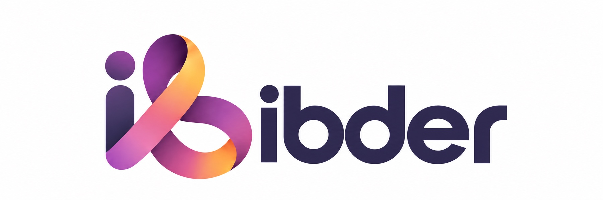

**[简体中文](README.md)** · English

  

# IBDer

**An open community where people living with IBD co-build research and tools.**

From trustworthy research and policy information to the incubating IBDer App and future open tools.

## What we are building

| Area | Focus | Status |
| --- | --- | --- |
| [Research](https://github.com/IBDer/research) | Traceable research updates, evidence, and regional policy information | Building |
| [IBDer App](https://github.com/IBDer/IBDer) | A journal for food, medication, symptoms, and care events | Incubating |

> Descriptions above are **long-term directions**, not the scope of any released or currently planned version. Version scope is defined by the spec and ADRs in each repository.
| Open tools | Reusable tools shaped by real patient needs | Planned |

## Boundaries

IBDer is an independent, patient co-built open-source community. It is not affiliated with a hospital, pharmaceutical company, or commercial organization. We do not provide diagnosis, individualized treatment advice, telemedicine, or emergency services, and we do not publish identifiable patient information.

Community content cannot replace professional medical advice. Contact local emergency services in an emergency.

The statements above are IBDer's **public commitments**. The internal capability boundary of the product is recorded in the ADRs of [IBDer/IBDer](https://github.com/IBDer/IBDer). Where the two conflict, these public commitments prevail.

## Participate

You can improve sources, raise needs, test tools, or contribute design and code. Start in [Discussions](https://github.com/orgs/IBDer/discussions) and read our [contribution guide](https://github.com/IBDer/.github/blob/main/CONTRIBUTING.md) and [privacy rules](https://github.com/IBDer/.github/blob/main/PRIVACY.md).

IBDer is driven by patient needs, governed by human judgment, and supported by AI in research, design, development, and maintenance. Material AI involvement is disclosed, and human maintainers remain accountable.

